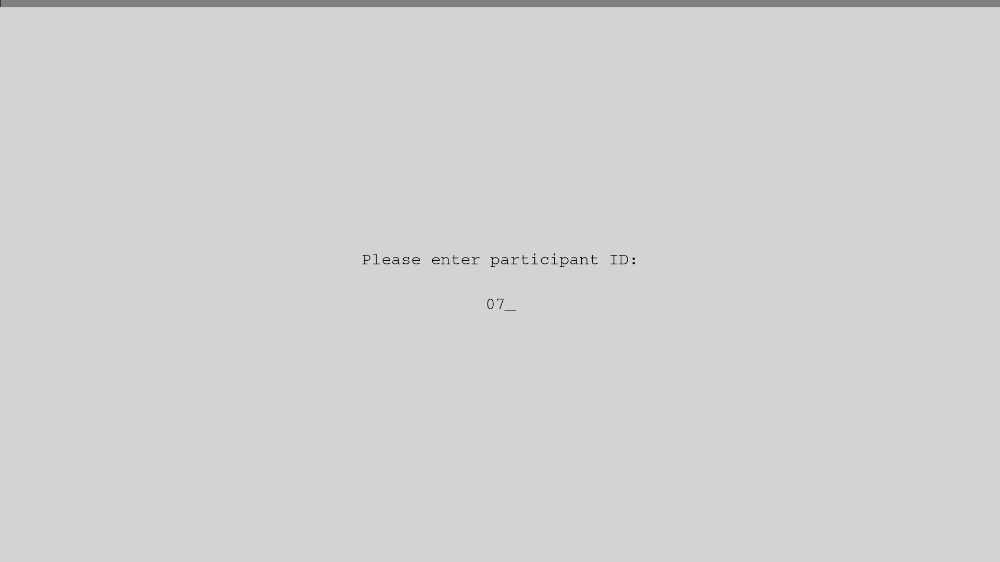
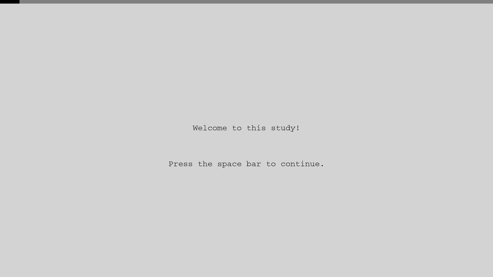
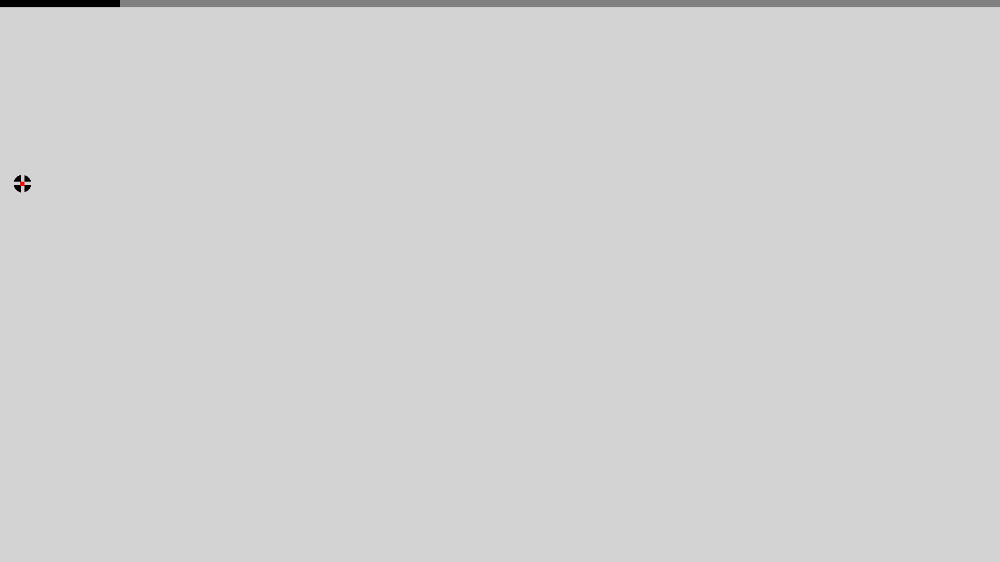
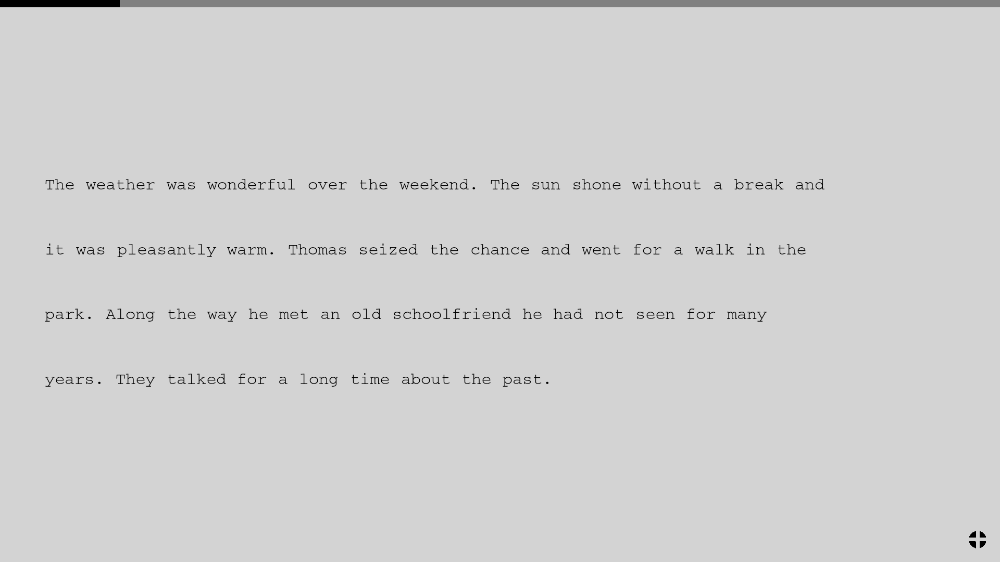
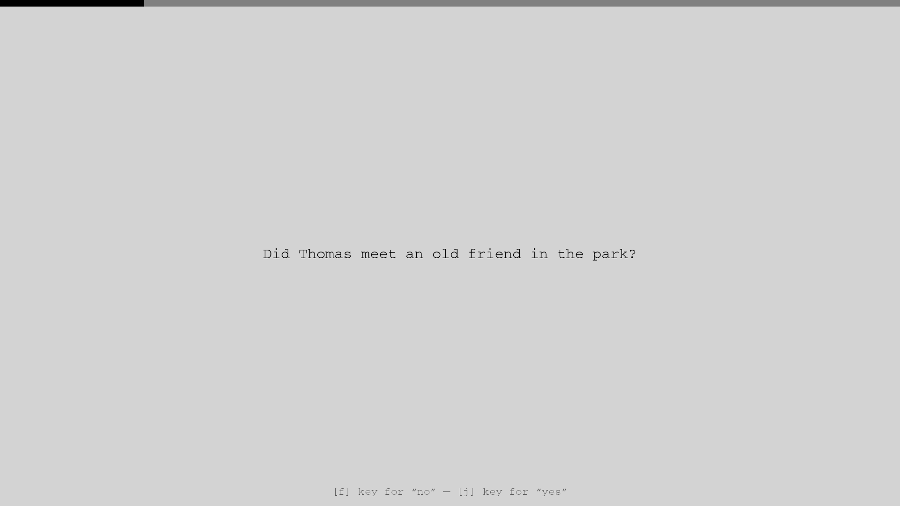
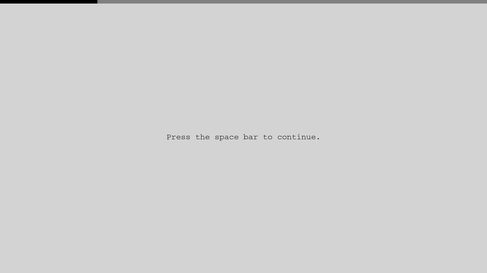

# Chamois

Chamois is a Python application that aims to make state-of-the-art
eye-tracking experiments on reading behavior as easy as possible. The focus
is on stimulus presentation and recording of user responses. It is written
in [Pyglet](https://pyglet.org); the engine (`chamois.py`) doesn't depend on
any particular eye-tracker, and full support for VPixx TRACKPixx3/DATAPixx3
(`TPx.py`) and SR Research EyeLink (`EyeLink.py`) trackers is included. The
page model, Latin-square counterbalancing and session-log format are those
of the earlier FreeSimpleGUI version, so existing analysis code keeps
working.

**Status:** Chamois is work in progress.  I wrote it for my own lab and share it without any warranty.  It seems to work pretty well, but definitely has some rough edges.  If you’re interested in using it, feel free to contact me to discuss it.

**What changed compared to the FreeSimpleGUI version:**
- **Pyglet** instead of FreeSimpleGUI: one fullscreen window with an
  offscreen framebuffer, no other GUI toolkit.
- **Layout in height units:** font size, spacing, margins and text position
  are fractions of the screen height (1.0 = full height), so an experiment
  looks the same on any screen and resolution.
- **Data in pixels:** word AOIs and gaze samples are saved in screen pixels,
  origin top left, y down (as in the FreeSimpleGUI version and in the
  screenshots). AOIs and gaze can therefore be compared directly; the screen
  resolution is logged with every row.
- **TRACKPixx3 gaze follower:** real-time gaze markers on the experimenter's
  console monitor while the participant's display stays clean (DATAPixx3 M16
  mode); condition codes stamped into every eye sample; mid-session
  recalibration.
- **EyeLink support:** calibration and validation inside the experiment,
  run from the Host PC; the EDF with trial messages and interest areas for
  Data Viewer, plus a per-trial CSV of the gaze samples; every page shown on
  the Host PC, with the live gaze during reading trials; mid-session
  recalibration.
- **Short experiment scripts:** an experiment is a list of pages and one
  call of `chamois.run_experiment()`. Settings have defaults and are changed
  from the script, so `chamois.py`, `TPx.py` and `EyeLink.py` never have to
  be edited. Four demos show the range, from a hello-world script without
  eye-tracking to a multi-line EyeLink experiment. Without a connected
  tracker the tracker demos run as plain reading experiments
  (keyboard-driven).

**Key features:** blinking fixation target at trial
start; trial ends when the participant looks at the lower-right corner;
sanity checks of stimuli (words that would not fit stop the experiment
before it starts); Latin square designs with automatic choice of the most
underrepresented list.

**A non-feature:** not designed for timing-sensitive display changes (e.g.
the boundary paradigm).

## Files

| File | What it is for |
| :--- | :--- |
| `demo_experiment.py` | Hello world: a few sentences in the script itself, no eye-tracking. Start here. |
| `demo_experiment_tpx.py` | TRACKPixx3 experiment: practice, targets and fillers from files, one sentence per line. |
| `demo_experiment_eyelink.py` | The same experiment with the EyeLink. |
| `demo_experiment_eyelink_multiline.py` | EyeLink experiment with longer texts over several lines. |
| `stimuli.tsv`, `fillers.tsv`, `stimuli_multiline.tsv`, `fillers_multiline.tsv` | The demos' stimuli. |
| `chamois.py` | The engine: pages, window, layout, session log, Latin square. Knows nothing about eye trackers. |
| `TPx.py` | The TRACKPixx3/DATAPixx3 layer: gaze recording and markers, condition codes, recalibration, dry run. |
| `EyeLink.py` | The EyeLink layer: calibration, gaze recording (EDF and CSV), Host PC display, recalibration, dummy mode. |
| `setup_once.py` | One-time installer for the eye tracker demos: uv, the dependencies (including SR Research's `pylink`), and VPixx's `pypixxlib`. |
| `aoi_check.py` | Analysis check: draws each trial's AOIs and gaze samples over its screenshot. |
| `pyproject.toml`, `uv.lock`, `.python-version` | Dependency and Python version pinning. |
| `images/` | Screenshots for this README. |

Created on the machine and not part of the repository: `data/` (logs,
screenshots and eye-tracking files of every session),
`tested_latin_square_lists.txt` (which Latin-square list each session ran;
the next session gets the least-used list) and `vendor/` (`pypixxlib`,
downloaded by `setup_once.py`).

## Running

The hello-world demo needs only [uv](https://docs.astral.sh/uv/):

```bash
uv run demo_experiment.py
```

The eye tracker demos need a one-time setup per machine:

```bash
python3 setup_once.py                  # once per machine (needs internet)
uv run demo_experiment_tpx.py          # or demo_experiment_eyelink.py, ...
```

`pypixxlib` is proprietary VPixx software and not on PyPI; `setup_once.py`
downloads it from the [official VPixx site](https://docs.vpixx.com/download)
into `vendor/`. SR Research's `pylink` comes from PyPI (`sr-research-pylink`)
and needs no EyeLink Developers Kit. A lab machine kept offline after setup
needs `offline = true` in uv's config (`setup_once.py` explains this at the
end). Python 3.12 or newer; developed and tested on Linux with X11.

**TRACKPixx3:** calibrate in LabMaestro first, then run the script.

**EyeLink:** the Display PC needs the static address 100.1.1.2 on the
Ethernet port connected to the Host PC (the Host's own address is the
setting `host_ip`). Calibration is part of the experiment, right after the
participant ID, and is run from the Host PC (Escape there continues with the
experiment). Sample rate, eye(s), pupil measure and calibration grid are
set on the Host PC only; the script prints them at the start but never
changes them. At the end, the session's EDF is copied into
`data/eyetracking/`.

## Stimuli

Stimuli are either written into the script (hello-world demo) or loaded
from a file with `chamois.load_stimuli("stimuli.tsv")`. A stimulus file has
four columns and no header: item, condition, sentence, question. It is
tab-separated (`.tsv`) or comma-separated (`.csv`; a sentence that contains
a comma goes in double quotes). A literal `\n` in a sentence starts a new
line on screen.

```text
1	a	While Bill hunted the deer was hunted by Bill.	Did Bill hunt the deer?
1	b	While Bill hunted the deer that was brown and nimble\nwas hunted by Bill.	Did Bill hunt the deer?
```

A faulty file (wrong number of columns, an empty cell, an item number that
is not a number) or an unbalanced Latin square (an item with a missing or
different condition) stops the script with a message naming the file, line
or item, before the experiment window opens.

## Experiment structure

An experiment is a list of pages shown one by one; each page is one row in
the session log. The whole of an EyeLink experiment, in short (see
`demo_experiment_eyelink.py`):

```python
import random
import chamois
from EyeLink import EyeLink

tracker = EyeLink()

stimuli = chamois.next_latin_square_list(chamois.load_stimuli("stimuli.tsv"))
stimuli += chamois.load_stimuli("fillers.tsv")
random.shuffle(stimuli)

pages = []
pages.append(chamois.SubjectIDPage())
pages.append(tracker.CalibrationPage())
pages.append(chamois.CenteredInstructions("Welcome to this study!"))
for item, condition, sentence, question in stimuli:
    pages.append(tracker.ReadingTrial(item, condition, sentence))
    pages.append(chamois.YesNoQuestionTrial(item, condition, question, percent=50))
    pages.append(chamois.Next())
pages.append(chamois.CenteredInstructions("Thank you for your participation!"))

chamois.run_experiment(pages, tracker)
```

For the TRACKPixx3 it is `from TPx import TPx`, `tracker = TPx()` and no
calibration page; without an eye tracker, `chamois.ReadingTrial(...)` and
`chamois.run_experiment(pages)`.

Page types: `CenteredInstructions`, `SubjectIDPage`, `ReadingTrial`,
`CalibrationPage` (EyeLink only), `Next` (break) and two kinds of
comprehension question: `YesNoQuestionTrial` (answered with f/j, logged as
`yes`/`no`) and `ComprehensionTrial` (typed answer, confirmed with Enter,
logged as typed). An experiment can mix both. New types: subclass
`chamois.Page`.

## Settings

Everything has a default, and nothing has to be changed to run an
experiment. Settings are changed in the experiment script, never in
`chamois.py`, `TPx.py` or `EyeLink.py`. These are the ones most experiments
touch:

| Setting | Default | Where it is set | What it does |
| :--- | :--- | :--- | :--- |
| `fontsize` | `0.03` | `chamois.settings(...)` | Font size, as a fraction of the screen height (0.03 = 3 %, ≈ 32 px on a 1080p screen). |
| `align` | `'left'` | `ReadingTrial(...)` | Line alignment: `'left'`, `'center'` or `'right'`. |
| `cross_position` | `'center'` | `ReadingTrial(...)` | The blinking fixation cross: `'left'` (just before the first word), `'center'` (middle of the text) or `'right'` (after the first line). |
| `wrap` | `None` | `ReadingTrial(...)` | Automatic line breaks after at most this many characters. A text with a manual `\n` always keeps its own breaks. |
| `percent` | `100` | `YesNoQuestionTrial(...)`, `ComprehensionTrial(...)` | The share of the questions that is actually asked, e.g. 50 = after half of the trials, drawn anew for each session. |
| `host_ip` | `"100.1.1.1"` | `EyeLink(...)` | Address of the EyeLink Host PC. |
| `drift_check` | `False` | `EyeLink(...)` | `True`: a drift check at the fixation cross before every reading trial. |

```python
chamois.settings(fontsize=0.035)
tracker = EyeLink(host_ip="102.1.1.1", drift_check=True)
tracker.ReadingTrial(item, condition, sentence, wrap=70, cross_position='left')
chamois.YesNoQuestionTrial(item, condition, question, percent=50)
```

A misspelled name or an impossible value stops the script with the list of
valid ones, before the experiment window opens.

### Additional settings

Rarely needed; all sizes are in **height units** (fractions of the screen
height, 1.0 = full height) and all colors are (R, G, B) from 0 to 255.

**Reading trial**, as further arguments of `ReadingTrial(...)`:

| Setting | Default | What it does |
| :--- | :--- | :--- |
| `y_offset` | `0.0` | Height of the text on the screen; 0 = middle, positive = higher. |
| `trigger_radius`, `trigger_dwell` | the tracker's | The tracker settings of the same name (below), for this trial only. |

**Whole experiment**, with `chamois.settings(...)`:

| Setting | Default | What it does |
| :--- | :--- | :--- |
| `font_name` | `('Courier', 'Courier New', 'DejaVu Sans Mono', 'Liberation Mono')` | Font; the first one installed is used. Use a monospaced font. |
| `wordspacing` | `0.02` | Gap between words. |
| `linespacing` | `0.04` | Extra space above and below each line. |
| `left_margin` | `0.08` | Margin of left- and right-aligned text. |
| `cross_size` | `0.04` | Size of the fixation cross. |
| `screen_number` | `0` | Which monitor shows the experiment. |
| `background_color` | `(211, 211, 211)` | Screen background (light gray). With the DATAPixx3 only grays work. |
| `text_color` | `(0, 0, 0)` | Stimulus text. |
| `hint_color` | `(90, 90, 90)` | Key hints such as "press the space bar". |
| `line_dot_color` | `(255, 0, 0)` | The dot in the middle of the fixation cross. |
| `continue_text` | `"Press the space bar to continue."` | Texts the participant sees besides the stimuli; change these four to translate the experiment. |
| `yesno_hint` | `"[f] key for “no” — [j] key for “yes”"` | |
| `answer_hint` | `"Type your answer and press Enter to confirm."` | |
| `subject_id_prompt` | `"Please enter participant ID:"` | |

**Eye tracker**, with `TPx(...)` or `EyeLink(...)`:

| Setting | Default | What it does |
| :--- | :--- | :--- |
| `gaze_display` | `'console'` (TPx), `'host'` (EyeLink) | On which screen the live gaze is shown. By default only the experimenter sees it (console monitor or Host PC); `'both'` also shows it to the participant, e.g. for piloting. TPx also has `'stimulus'` (participant screen only). |
| `gaze_marker` | `'eyes'` | One marker per eye (`'eyes'`) or one marker at the average of both eyes (`'average'`). |
| `marker_radius` | `0.01` | Size of the gaze markers. |
| `trigger_radius` | `0.19` | Size of the lower-right region that ends a reading trial. |
| `trigger_dwell` | `0.08` | Seconds the gaze must stay in that region. |
| `stimulus_marker_gray` (TPx) | `180` | Brightness (0–255) of the markers the participant sees. |
| `show_eye_image` (TPx) | `False` | `True`: leave the DATAPixx3's eye-camera image on the console monitor. |
| `show_dry_run_tag` (TPx) | `False` | `True`: without a DATAPixx3, show a visible stand-in for the condition-code pixel (for testing). |
| `host_display` (EyeLink) | `'image'` | What the Host PC shows: the page as an image, or `'text'` (words drawn in the Host's own font). |
| `host_text_color`, `host_cross_color`, `host_trigger_color` (EyeLink) | `15`, `4`, `2` | Host PC palette colors (white, red, green) used with `host_display='text'`. |

With the EyeLink, which eye is recorded (left, right or both), the sample
rate and the calibration grid are not settings of the script: they are
chosen on the Host PC. The same explanations stand next to each setting at
the top of `chamois.py`, `TPx.py` and `EyeLink.py`.

## Session log

All data goes to `data/`: `logs/`, `screenshots/` and `eyetracking/`. Every
filename starts with participant ID, date/time and Latin-square list, e.g.
`07_2026-07-14_14-59-59_list-a`. The session log (`data/logs/<prefix>_log.tsv`)
has one row per page:

1. `pno`: page number.
2. `type`: page type.
3. `starttime`, 4. `endtime`: seconds since the start of the experiment.
5. `item`, 6. `condition`: of the displayed stimulus.
7. `stimulus`: the displayed text.
8. `response`: the answer, the participant ID, `ABORTED` or `RECALIBRATED`;
   with the EyeLink also the validation result (`CalibrationPage`) or
   `HOST_SKIP` (trial skipped from the Host PC's abort menu).
9. `screenshot`: the page's screenshot in `data/screenshots/`.
10. `metadata1`: for reading trials, one AOI per word as
    `left,top,right,bottom` in pixels (origin top left, y down).
11. `metadata2`: for reading trials, the eye-tracking file in
    `data/eyetracking/` (gaze in the same pixel coordinates; eye lost =
    `32767` with the TRACKPixx3, `-32768` with the EyeLink).
12. `screen_width`, 13. `screen_height`: the screen resolution in pixels.

`data/logs/<prefix>_pixel-codes.tsv` decodes the condition stamped into the
TRACKPixx3 eye data's `DigitalOut` column (`DigitalOut >> 16 & 0xFF`).

With the EyeLink, the per-trial CSV holds the samples from word onset to
the end of the trial (`TimeTag` in the tracker's milliseconds, gaze and
pupil per eye, pixels per degree); the columns of an eye that is not
recorded stay empty. The session's EDF (`data/eyetracking/<prefix>.edf`)
contains the calibrations and, for each reading trial, `TRIALID <page>
<item> <condition>`, trial variables (page, item, condition, CSV file), one
interest area per word, `SYNCTIME` at word onset, the screenshot as Data
Viewer background, and `TRIAL_RESULT`.

## Ending a reading trial

1. **Looking at the lower-right corner** (the normal way with an eye
   tracker; region size `trigger_radius`, also per trial:
   `tracker.ReadingTrial(..., trigger_radius=0.25)`).
2. **Space** — fallback when calibration is poor, and the way without an
   eye tracker.
3. **Escape** aborts the trial (logged as `ABORTED`).
4. **Ctrl+Q** aborts the experiment; the log so far is saved.

On instruction and break screens, **r** starts a recalibration: in
LabMaestro with the TRACKPixx3, from the Host PC with the EyeLink. With the
EyeLink, the Host PC's abort menu (Ctrl+Alt+A) can also skip the current
trial or end the experiment. Experimenter keys are never shown on screen.

## Screenshots

Participant ID:


Instructions:


Blinking fixation cross at the start of a reading trial:


Reading trial (the cross in the lower-right corner is the look target that
ends the trial):


Comprehension question:


Break between trials:

